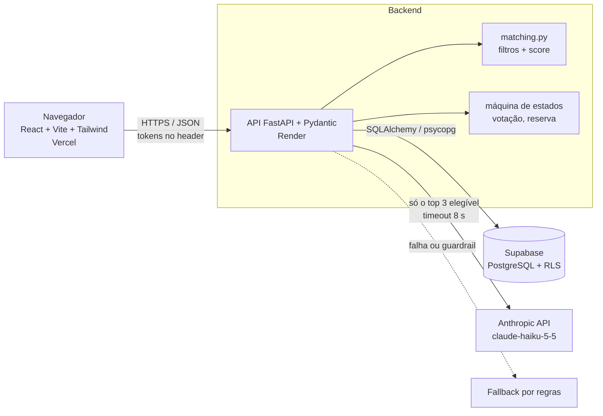

# iFood Match — Onde todo mundo combina

Solução para o **case AI Builder do iFood, opção 3 (Decisão em grupo)**: ajudar um grupo de amigos, com orçamento fixo, a decidir onde comer fora, reservar e voltar.

| | |
|---|---|
| **App** | __APP_URL__ |
| **Demonstração direta** | __APP_URL__/demo (cria um grupo com 4 amigos fictícios já preenchidos) |
| **API** | __API_URL__ ([documentação interativa](__API_URL__/docs)) |
| **Métricas (restritas)** | __APP_URL__/metricas, só com a chave `ADMIN_TOKEN` |

> Protótipo de case com dados 100% fictícios. Restaurantes, avaliações, benefícios e disponibilidade são inventados, e toda reserva é **simulada** (na interface e no banco, `is_simulated = true`). Não usa marca, dados internos ou dados de clientes do iFood. Participantes usam apelidos.
>
> A API roda no plano gratuito do Render, que hiberna: o primeiro acesso pode levar cerca de 1 minuto (a interface avisa "Acordando o servidor"). Antes de apresentar, abra o link alguns minutos antes.

## O problema

Cinco amigos querem jantar. Cada um tem um orçamento, uma culinária preferida, uma restrição alimentar e mora num canto da cidade. A decisão se arrasta no grupo de mensagens e, às vezes, ninguém chega a um consenso.

**Para quem:** grupos de amigos, colegas ou familiares que querem comer fora e precisam conciliar preferências e orçamento.

**Valor para o iFood:** mais descoberta de restaurantes do Comer Fora, mais reservas, menos abandono na escolha e uma porta de entrada para fidelização (avaliação e "bora de novo").

## A solução

Uma plataforma colaborativa que reúne as preferências de cada pessoa, filtra e pontua restaurantes com um algoritmo transparente, usa IA para explicar o porquê de cada sugestão e conduz o grupo até a votação, a reserva (simulada) e a avaliação.

**O algoritmo decide e a IA explica.** Orçamento, restrições alimentares, capacidade e disponibilidade são regras determinísticas; a IA nunca decide sobre elas.

## Como usar em 2 minutos

1. Abra o app e clique em **ou veja um exemplo pronto**, logo abaixo de "Criar encontro" (ou vá direto em `/demo`). Um grupo com Ana (vegetariana), Bruno (orçamento de R$ 60), Carla (mora longe, em Santana) e Davi (sem glúten) já está pronto.
2. Clique em **Gerar Match**. Veja o top 3, a explicação de cada restaurante, o ponto de atenção e, em **Ver por que**, o score de cada pessoa.
3. Vá para a **Votação**. No seletor "Você está como", troque de pessoa e vote como cada uma. O placar atualiza sozinho.
4. **Encerre a votação** (em caso de empate, vence o maior score coletivo), **confirme a reserva simulada** e **avalie**.
5. Recarregue a página: está tudo salvo. O funil fica em `/metricas`, que exige a chave de acesso.

Para testar do zero: **Criar encontro**, compartilhe o link (ou use **+ Adicionar pessoa neste aparelho** para entrar como outras pessoas na mesma aba) e siga o fluxo.

## As seis telas

| Tela | O que faz |
|---|---|
| Início | Página limpa: proposta em uma frase, o botão **Criar encontro** e um link discreto para o exemplo pronto |
| Criar encontro | Nome, data, horário, orçamento, pessoas, bairro, ocasião e prazo opcional; gera código e link com botões de copiar e de compartilhar no WhatsApp |
| Preferências | Texto livre com IA, que pré-preenche o formulário; a pessoa confere e salva; painel de quem já respondeu; Match (ou "gerar com quem já respondeu", para o organizador) |
| Resultados do Match | Top 3 com score, preço, culinária, bairro, distância, explicação da IA, ponto de atenção e detalhamento por participante; estado "nenhum elegível" com sugestões aplicáveis |
| Votação | Um voto por pessoa (trocar o voto atualiza, não duplica), placar a cada 3 s, encerramento pelo organizador, desempate explicado |
| Reserva e retorno | Selo **Reserva simulada**, resumo, avaliação de 1 a 5 com comentário e "novo encontro com minhas preferências" |
| Métricas (restrita) | Funil real a partir da tabela `events`, tempo até a decisão, participação e uso de IA; fora do menu e protegida por chave |

## Arquitetura



O frontend fala só com o backend. As credenciais do banco e da IA ficam apenas nas variáveis de ambiente do Render.

```
frontend/            React (6 telas + /metricas), vercel.json com rewrite de SPA
backend/app/
  api/               rotas: groups, participants, recommendations, votes, reservations, ai, metrics
  services/          matching.py (motor), ai_service.py (IA + guardrails + fallback),
                     match_service.py, decision_service.py, state_machine.py, auth.py, events.py, demo.py
  models/tables.py   9 tabelas (8 do docx + events)
backend/migrations/  001_schema.sql, 002_seed_restaurants.sql (geradas dos modelos e do seed)
backend/scripts/     migrate.py, acceptance.py (8 critérios contra qualquer URL), build_migrations.py
data/                reference.json, restaurants_seed.json (50 fictícios), generate_seed.py, validate_seed.py
tests/               pytest (motor, API, IA mockada, aceite) e e2e/ui_flow.py (Playwright)
docs/                PROCESS.md (slide de processo), DECISIONS.md
```

## Regras do Match

**Etapa A — filtros obrigatórios**, aplicados antes de qualquer ranking:

- preço médio ≤ o menor entre o orçamento do grupo e o limite individual de cada participante;
- todas as restrições alimentares de qualquer participante atendidas;
- capacidade ≥ tamanho do grupo;
- restaurante aberto e com mesa (disponibilidade simulada, determinística) na data e hora.

Se nada sobrar, o app mostra quantos restaurantes cada filtro eliminou e sugere ajustes concretos, por exemplo "Subindo o orçamento por pessoa de R$ 40 para R$ 55, surgem 3 opções". O organizador aplica a sugestão com um clique. Restrição alimentar nunca é relaxada automaticamente.

**Etapa B — score por participante**, cada componente de 0 a 100:

```
S = 0,40·G + 0,25·P + 0,20·L + 0,15·A
```

- **G (gastronomia):** 100 se a culinária é favorita, 25 se não é, 60 se a pessoa não informou.
- **P (custo-benefício):** preço relativo ao orçamento da pessoa (80%) + avaliação (20%).
- **L (localização):** distância de Haversine do bairro de saída; 100 na porta, 40 no limite da pessoa, 0 no dobro do limite.
- **A (ambiente):** proporção dos ambientes desejados; −30 para o oposto (tranquilo × animado).

**Score do grupo** = média dos individuais − 0,5 × (50 − pior individual), quando o pior fica abaixo de 50. Um lugar ótimo para quatro e péssimo para um perde para um lugar bom para todos.

**Etapa C — IA.** A IA recebe só o top 3 elegível, os scores e um resumo das preferências, e escreve "Por que o iFood Match recomendou este restaurante?" com o principal ponto de atenção. Guardrails no código descartam a explicação que cite outro restaurante, invente preço ou afirme segurança alimentar. Se a API falhar ou passar de 8 s, a explicação vem de um template com os mesmos dados.

**Regras de negócio** (todas com teste):

- o Match fica indisponível enquanto faltar alguém, mas o organizador pode gerar com quem já respondeu, com no mínimo 2;
- mudar uma preferência depois do Match invalida o ranking e os votos e abre nova rodada;
- votar de novo atualiza o voto;
- em empate, vence o maior score coletivo;
- a reserva só existe depois da escolha concluída, e no máximo uma por grupo;
- recarregar a página recupera tudo.

## IA no produto

| Função | Entrada | Saída | Proteções |
|---|---|---|---|
| A — Interpretar preferências | Texto livre ("quero um lugar tranquilo, não muito caro, sou vegetariana") | JSON com schema (culinárias, restrições, ambientes, bairro, distância, orçamento) | Só valores permitidos; números só se escritos pela pessoa; a pessoa confere o formulário antes de salvar; fallback por palavras-chave |
| B — Explicar recomendações | Top 3 elegível + scores + resumo do grupo | Uma explicação por restaurante | Ids e nomes conferidos; preços conferidos; frases de segurança alimentar bloqueadas; cache por rodada; registro de IA ou fallback |

Os prompts e como evoluíram estão em [docs/PROCESS.md](docs/PROCESS.md).

## Métricas

**Métrica principal:** percentual de grupos criados que concluem a escolha de um restaurante.

**Complementares:** funil (grupo criado → preferências completas → recomendações vistas → escolha concluída → reserva simulada), tempo médio até a decisão, taxa de participação, decisões por desempate, rodadas invalidadas, explicações com IA ou fallback e avaliação média.

Os eventos são registrados de verdade na tabela `events`, mas são **dados de uso do protótipo**, não conversões reais. Grupos de demonstração ficam fora por padrão.

## Riscos e como foram tratados

| Risco | Tratamento |
|---|---|
| IA inventar informações | Recebe só elegíveis; guardrails por explicação; fallback |
| Recomendar acima do orçamento | Filtro obrigatório antes do ranking; teste com 300 grupos aleatórios |
| Ignorar alergias ou restrições | Filtro obrigatório; IA proibida de afirmar segurança; aviso para confirmar com o restaurante |
| Grupo não chegar a consenso | Encerramento pelo organizador, prazo opcional, desempate pelo score |
| Acesso a grupos indevidos | Convite aleatório de 8 caracteres, tokens por participante e de organizador (só o hash no banco), rate limit, CORS restrito, RLS no Supabase |
| Exposição de dados pessoais | Só apelidos (e-mail e telefone são recusados) e localização por bairro |
| Falha da API de IA | Timeout de 8 s e fallback por regras registrado no banco |
| Reserva não ser real | `CHECK (is_simulated = true)` no banco e selo na interface |

Detalhes, com o arquivo de cada tratamento, em [docs/PROCESS.md](docs/PROCESS.md#3-riscos). Decisões tomadas durante a construção: [docs/DECISIONS.md](docs/DECISIONS.md).

## Como rodar localmente

Requisitos: Python 3.13 e Node 20 ou mais novo.

```bash
# Backend (sem DATABASE_URL usa SQLite local; sem ANTHROPIC_API_KEY usa o fallback por regras)
python -m venv .venv
.venv/Scripts/pip install -r backend/requirements.txt   # no Linux/Mac: .venv/bin/pip
cp backend/.env.example backend/.env                      # opcional: preencha as chaves
cd backend && ../.venv/Scripts/uvicorn app.main:app --reload --port 8000

# Frontend (outro terminal)
cd frontend && npm install && npm run dev                 # http://localhost:5173
```

Com Postgres, coloque a connection string do Supabase (Session pooler) em `DATABASE_URL` e rode `python backend/scripts/migrate.py`.

### Testes

```bash
.venv/Scripts/pip install pytest httpx
.venv/Scripts/python -m pytest tests/                       # motor, API, IA mockada e os 8 critérios de aceite
python data/validate_seed.py                                # valida a base de restaurantes
python backend/scripts/acceptance.py __API_URL__            # 8 critérios contra a API publicada
python tests/e2e/ui_flow.py __APP_URL__                     # interface com Playwright (pip install playwright)
```

## Deploy

- **Backend:** Render Blueprint ([render.yaml](render.yaml)). Aplica as migrations no start. Variáveis no painel: `DATABASE_URL`, `ANTHROPIC_API_KEY`, `CORS_ORIGINS`, `FRONTEND_URL` e `ADMIN_TOKEN`.
- **Frontend:** Vercel, com raiz `frontend/` e a variável `VITE_API_URL` apontando para o Render; [vercel.json](frontend/vercel.json) faz o rewrite de SPA.
- **Banco:** Supabase (PostgreSQL), acessado só pelo backend; RLS ativo sem policies.
